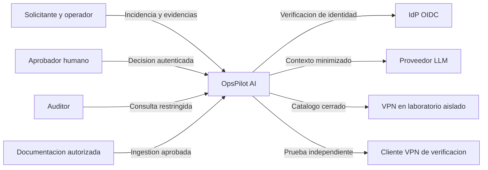
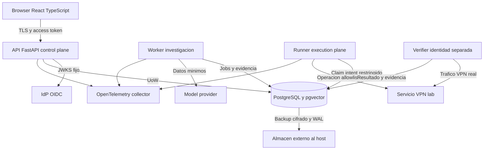
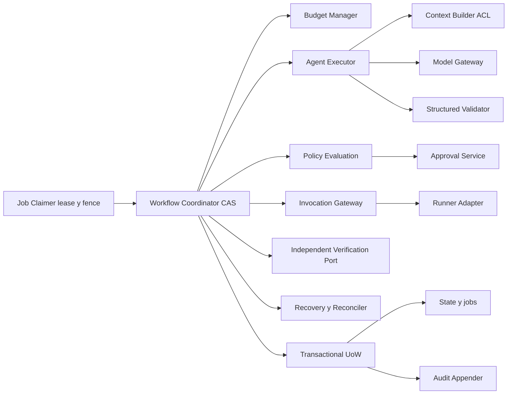
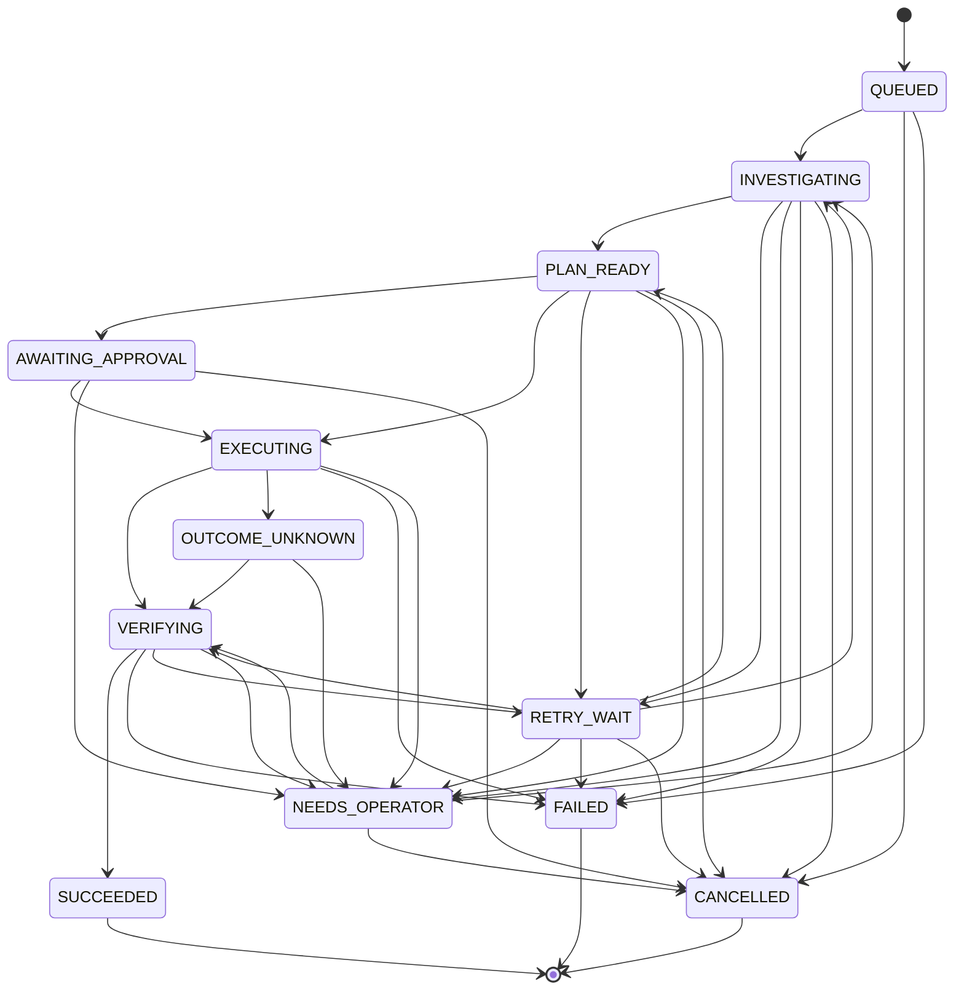
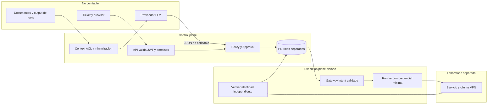
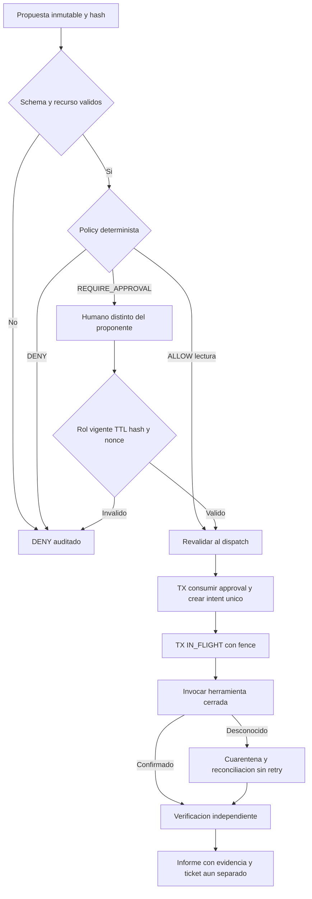

# Diagramas de arquitectura objetivo

Estado: PROPUESTO; vistas C4 expresadas con flowchart Mermaid portable. Flechas son
interfaces autorizadas, no despliegues existentes. Las guardas normativas están en
[motor](WORKFLOW_ENGINE.md), [API](API_CONTRACTS.md) y [datos](DATA_MODEL.md).

## C4 System Context



## C4 Container



## C4 Component — orquestador



## Secuencia VPN end-to-end

```mermaid
sequenceDiagram
  actor Operador
  participant API
  participant PG
  participant Worker
  participant RAG
  participant LLM
  participant Policy
  actor Aprobador
  participant Runner
  participant VPN
  participant Verifier
  Operador->>API: Ticket + token + idempotency key
  API->>PG: TX ticket + QUEUED + job + audit
  PG-->>API: Commit
  API-->>Operador: 202 con IDs
  Worker->>PG: Claim job + lease/fence
  Worker->>RAG: Query con ACL
  RAG-->>Worker: Chunks y hashes autorizados
  Worker->>LLM: Contexto acotado, schema, budget
  LLM-->>Worker: Diagnostico provisional y recomendacion
  Worker->>Policy: Propuesta validada y sujeto/recurso
  Policy-->>Worker: REQUIRE_APPROVAL
  Worker->>PG: TX AWAITING_APPROVAL + audit
  Aprobador->>API: Aprobar snapshot inmutable
  API->>PG: TX verificar rol, TTL, nonce y decision
  Runner->>PG: TX revalidar, consumir approval, preparar intent
  Runner->>PG: TX IN_FLIGHT antes de enviar
  Runner->>VPN: restart(operation_id) allowlisted
  alt Resultado confirmado
    VPN-->>Runner: Resultado con evidencia
    Runner->>PG: TX resultado + VERIFYING + job + audit
    Verifier->>VPN: Tunel desde cliente y trafico al recurso
    Verifier->>PG: TX evidencia independiente y estado final
  else Timeout o crash tras envio
    Runner->>PG: UNKNOWN y cuarentena al recuperar lease
    Runner->>VPN: Reconcile operation_id sin repetir accion
    Runner->>PG: Evidencia o NEEDS_OPERATOR
  end
  Operador->>API: Consultar informe; confirmar cierre si evidencia valida
```

## Máquina de estados

Lista de aristas deliberadamente explícita para comparar automáticamente con JSON.
Guardas, resume_state, cancel_requested y estados de intent están definidos en motor.



## Trust boundaries



## Aprobación y ejecución



Validación S01: correspondencia de aristas y fences Markdown por script. No se ha
renderizado Mermaid ni validado visualmente; render SVG/HTML con versión fijada
forma parte del gate documental S02 antes de publicar diagramas.
