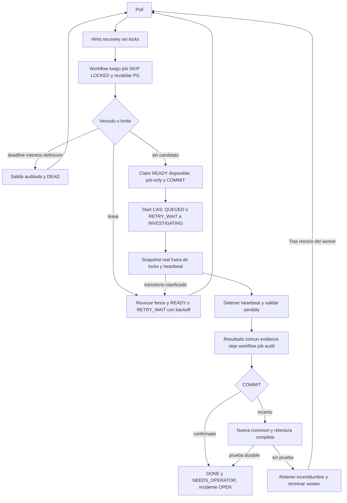

# S03 — revisión de recuperación T03-06

2026-10-25 Europe/Madrid. Autocrítica técnica del mismo asistente, no auditoría
independiente. Alcance exclusivamente T03-06 local; S03 sigue abierta. Sin commit,
push, merge, release, despliegue, IA ni operaciones IT. Estado verificable actual
en [verification.json](../../artifacts/session-03/recovery/verification.json).

## 1. Baseline y Git

main inicialmente limpio, HEAD 224c5ad5c648e231af6bef5bdceeab5c5c14d190.
CI plataforma 40054234985 y harness 40054235016 SUCCESS para ese SHA exacto:
quality Windows/Ubuntu, integración, PG fresco, recovery y tres scans. Consulta
read-only al conector GitHub, [entrada registrada](../../artifacts/session-03/recovery/entry-gate.json).
No se hereda ese PASS para los cambios locales. Snapshots T03-01..05 preservados.

El primer intento local de baseline se inició mientras arrancaba el lab y continuó
durante la edición: 670 PASS, 7 FAIL, 38 ERROR, incluido drift de modelos cargados
antes de 0003. Es una ejecución contaminada, no baseline válido. Check inicial
detectó el SHA público de entrada como falso positivo; se guarda con clave head
reconocida por el scanner. No se exceptúan secretos. Regresión final separada.

## 2. Diseño de recovery

[Spec previa](../../specs/003-workflows/recovery.md): REQ-WF-02 → T03-06 →
AC03-04/05/06/07/09. Se reutiliza worker/Jobs/PostgresJobUow y contratos cerrados.
0003 añade dos campos de accounting, constraint, índice y dos funciones acotadas;
0001/0002/appender v2 intactos. No tablas futuras, dependencias ni endpoints nuevos.
Incidente permanece OPEN; resultado nominal NEEDS_OPERATOR no expresa resolución.

## 3. Algoritmo reclaim

PostgresJobs.recover selecciona hasta 32 candidatos sin locks, después workflow y
job con SKIP LOCKED, relee estado/intención/tiempo y evita evidence ya confirmada.
LEASED vencido en QUEUED vuelve READY con fence+1; INVESTIGATING pasa RETRY_WAIT
con TRANSIENT_LOCAL_FAILURE y available_at PG + full jitter. Attempts se conserva;
el siguiente claim lo incrementa. DEAD/DONE/CANCELLED se excluyen. Reejecutar el
barrido no vuelve a invalidar READY normal. El loop barre antes de cada claim.

## 4. Concurrencia y locks

Claim sigue bloqueando solo job y confirma antes de start. Recuperación, heartbeat,
completion y cancel respetan workflow → job → step → audit. Reclaim nunca espera
workflow manteniendo job. Lectura de candidatos no concede ownership. Relectura
rechaza generación, versión, lease, definición o cancelación inválidas. La última
guarda de resultado ocurre después del appender; esperar audit no prolonga permiso.
Retry también revierte si caduca el lease durante audit. Primer commit válido
decide versión visible; cancel obsoleto recibe conflicto y exige releer.

## 5. Reintentos y presupuesto

Máximo tres claims, también si el proceso cae antes de start. U(0,min(30,2^attempts))
se persiste en available_at; READY futuro no se reclama. RETRY_WAIT conserva
resume_state INVESTIGATING y start emite RETRY_READY. Tercer fallo local acaba en
NEEDS_OPERATOR/RETRY_EXHAUSTED. Crash antes de start por tercera vez requiere las
dos aristas aprobadas QUEUED → INVESTIGATING → NEEDS_OPERATOR, sin ejecutar handler.

Solo POSTGRES_TRANSIENT clasificado después de start programa retry inmediato
durable. DB caída o commit incierto detienen el worker; recuperación posterior
relee DB. No retry genérico de excepciones, auth, schema o errores permanentes.
Deadline absoluto no cambia; QUEUED vence a FAILED, INVESTIGATING/RETRY_WAIT a
NEEDS_OPERATOR. No cerrar ticket ni inferir ausencia de futuros efectos externos.

Tiempo activo se contabiliza desde claim, incluye espera antes de start y excluye
READY/RETRY_WAIT. Renovación liquida hasta ahora; crash consume conservadoramente
hasta lease_until porque no se conoce la muerte física. Trigger guarda contador y
cursor en el mismo UPDATE; reclaim/cancel/liberación anulan cursor, sin doble cuenta.
Redondeo superior por segmento de hasta 1 ms. Workflows.budget_spent_ms se proyecta
en transiciones auditadas; jobs es la fuente entre ellas. Heartbeat no inventa
versiones/eventos. Histórico anterior a 0003 carece de accounting completo: se
conserva presupuesto conocido y última ventana de lease, sin fabricar historia.

## 6. Versionado

Definición distinta de 1 nunca ejecuta intake_snapshot v1. Bloqueo durable conserva
estado/definición, incrementa versión una vez, invalida job y emite
workflow.blocked/UNSUPPORTED_DEFINITION. Reinicio no vuelve a bloquear DEAD.
Cancel autorizado con versión actual sigue permitido. Sin migrador genérico.

## 7. COMMIT_UNCERTAIN

Jobs.complete abandona la sesión incierta y abre otro UoW/conexión. confirmed toma
workflow/job en orden para esperar la transacción anterior, relee step/evidence y
verifica DONE, fence, relaciones, versión, hash y NEEDS_OPERATOR; función SQL cerrada
comprueba evento v2 y head. Solo conjunto completo devuelve UUID confirmado.
Si falta prueba, conserva COMMIT_UNCERTAIN; no llama complete otra vez ni libera
ownership por suposición. La expiración y reclaim resolverán rollback real.
Incluso timeout/caída de DB durante esa relectura conserva COMMIT_UNCERTAIN: no
puede escapar como POSTGRES_TRANSIENT hacia retry. Se prueba con ACK real perdido
y lock independiente que fuerza timeout PostgreSQL de la relectura.

Test commit_transport usa proxy TCP local de bytes reales: en un caso reenvía
COMMIT a PG, observa CommandComplete y descarta ACK; en otro corta antes de reenviar
COMMIT y fuerza rollback real. No falsifica el resultado de session.commit.
Ambos usan observador/conexión independiente y comprueban un único resultado.

## 8. Kill points

recovery_process contiene exclusivamente hooks de tests y barreras stdin. Mata
procesos antes/después de commits de claim/start/resultado, durante snapshot,
antes/durante evidence y después de audit. Observador PG ve únicamente commits;
reinicio recupera READY/LEASED vencido o conserva DONE. JUnit registra estado,
owner/fence, intentos, versión, step y exit code. Sin sleeps ciegos como prueba.

## 9. Dos workers y 100 jobs

Resultados finales: nominal Windows 50/50 y Linux 51/49; tras matar ambos workers,
recuperación Windows 50/50 y Linux 49/51. En cada campaña: 100 jobs DONE, 100
evidencias lógicas únicas, incidentes OPEN y procesos de finalización exit 0/0.
Kills intencionales: 1/1 Windows y -9/-9 Linux, separados del éxito de recuperación.

Se conserva test_worker de T03-05. La campaña nueva mata simultáneamente dos
procesos tras start, espera vencimiento real de sus leases de 60 s mediante reloj
PG, usa dos reclaimers independientes y termina 100 jobs con dos workers reales.
Se verifican 100 evidencias lógicas, ningún DONE repetido y ningún elegible perdido.
Las 20 carreras cancel/reclaim/retry/heartbeat serializan locks reales; cancelación
postresultado y espera de audit se conservan como regresión T03-04/05.

## 10. Integridad de audit y evidence

Resultado/evidence/step/workflow/job/audit comparten transacción. UNIQUE de evidencia
y agregado/version, hash canónico y validación del appender permanecen. Fallo de
appender/constraint/commit revierte resultado completo. Integridad se verifica con
verify_chain en conexión independiente. No exactamente una ejecución física ni
exactly-once externo. Administrador DB sigue pudiendo reescribir datos: no es WORM.

## 11. Regresión Windows y Linux

| Entorno local | Total | Integración PG18/IdP | Nuevas recovery | Harness | Fallos/errors/skips |
|---|---|---|---|---|---|
| Windows / Python 3.13.14 | 755 PASS | 292 | 40 | 23 | 0/0/0 |
| Linux nativo no root / Python 3.13.14 | 755 PASS | 292 | 40 | 23 | 0/0/0 |

[JUnit Windows](../../artifacts/session-03/recovery/tests-windows-release-candidate.xml)
y [JUnit Linux](../../artifacts/session-03/recovery/tests-linux-final-clock.xml)
incluyen propiedades de kill points y procesos. Integraciones ejecutadas
secuencialmente; mismo código montado readonly en Linux, entorno Linux propio.
Sin venv Windows compartido ni integración sustituida por mocks.

Resultados ejecutados, XML, contadores y hashes en verification.json. Un PASS local
no acredita CI remota del árbol sin publicar. No excluir integración ni saltar
fallos críticos. El run interrumpido por recreación de PG se conserva como fallo
de campaña, sin atribuirle PASS ni modificar tests antiguos para ocultarlo.

La regresión larga encontró dos supuestos de fixtures: restauración literal de
0002 después de simular schema inválido y tokens PKCE session-scoped que caducaban
antes de los últimos tests HTTP. Se restaura la revisión original y se renuevan
tokens por módulo mediante IdP real, sin cambiar TTL ni validación de producto.
El test de heartbeat medía avance de reloj DB contra intervalo monotónico del host:
observó 11.386 s frente al mínimo supuesto de 14. Ahora comprueba renovación creciente
y vigencia/cota de 60 s con reloj PG; el intervalo real de thread sigue 15 s y su
test unitario lo comprueba. No se atribuye el desfase a una causa física no observada.

## 12. Scans y seguridad

Check completo Windows y Linux PASS: frozen lock, Ruff, mypy, arquitectura, Bandit,
secretos y pip-audit. Tres scans finales PASS, cero HIGH/CRITICAL; IDs/config OCI e
input_sha256 del árbol final verificados. PG fresco, reinicio con jobs pendientes
y recovery de plataforma PASS. Informes separados en artifacts/session-03/recovery.

Grants por columna conservados. Única ampliación: EXECUTE worker_result_confirmed,
solo boolean y solo worker. SECURITY DEFINER dueño no-login existente, search_path
fijo y sin SQL dinámico; no DML ni grants extra del dueño. Revocar PUBLIC y otorgar
worker antes de transferir dueño evita REVOKE ineficaz por migrador NOINHERIT.
Negativos reales comprueban app sin EXECUTE, worker sin ledger/idempotency ni
UPDATE de accounting; regresión conserva DDL/identidades/audit denegados.
Logs solo códigos/IDs, sin DSN ni textos. Scans nuevos por imagen en evidencia.

## 13. Defectos corregidos

Ausencia de reclaim/retry/accounting durable; elegibilidad RETRY_WAIT y resume;
confirmación de commit incierto sin relectura; permisos de función nueva tras
transferencia; protección de lease después de esperar audit en retry. La
regresión distinguirá defectos reales de ejecuciones contaminadas del laboratorio.

Las correcciones de fixtures existentes están acotadas: conftest renueva tokens
por módulo y reconecta administración para limpiar su DB después de reinicio;
test_identity restaura la revisión original; test_worker compara vigencia por PG;
seed de persistencia prepara jobs disponibles envejecidos frente al retroceso de
reloj demostrado. Se conserva la semántica de roles/CAS/cancel y los límites de
producto, sin skips ni eliminación de tests. Nueva función de accounting evita
retroceder el cursor; relectura fallida de COMMIT incierto ya no se vuelve retry.

## 14. Riesgos residuales

R01 sigue abierto hasta gates/aceptación completa S03. R02/R14 externos, privacidad,
IdP corporativo, backup/restore y mantenimiento R15/musl/linux-amd64 continúan.
Accounting tras crash es cota por lease, no CPU medida; historial previo a 0003
es incompleto. Transitorio sin DB no puede registrar retry hasta recuperar DB.
Sin supervisor/HA ni garantía de disponibilidad: se requiere worker activo y PG.
drain termina al primer vacío elegible, aunque existan retries futuros; producción
usa polling sin drain. Cualquier inconsistencia confirmada queda fail-closed.

Los vacíos intermitentes se reprodujeron en un diagnóstico real: tras 263 ciclos
de claim/start, un job que ya había sido reclamado tenía available_at
16:39:32.735840 UTC y PostgreSQL respondió 16:39:27.766156 UTC. Su selección fue
correctamente denegada por ser futuro. [Diagnóstico](../../artifacts/session-03/recovery/selection-diagnostic.json).
El primer muestreo corto de 600 lecturas no capturó el retroceso; ambos resultados
se conservan. No atribuir a SKIP LOCKED, pérdida de jobs ni causa física no observada.

Fixtures READY usan disponibilidad 30 s pasada y expiración corta 30 s pasada;
deadline corto se observa con margen de 10 s. Son datos efímeros envejecidos, sin
modificar los valores 60/15/300 s del producto. La espera de expiración real conserva
60 s de DB y añade observación acotada hasta 120 s del host. El cursor usa GREATEST
con el valor anterior y una prueba de reloj regresado verifica que no se cobra dos
veces. Backward clock puede retrasar expiry absoluto: operar PG con reloj estable
sigue siendo requisito de plataforma, sin sustituirlo por reloj del worker.

## 15. GO / NO-GO local T03-07

**GO técnico LOCAL para preparar T03-07**, con 755 PASS/OS, 292 integraciones
reales/OS y gates locales completos PASS. No inicia T03-07: publicación/CI del
nuevo SHA y aceptación global S03 siguen pendientes. Sin GO S04/producción.

Dictamen y gates efectivos exclusivamente en verification.json. No iniciar T03-07,
cerrar S03 ni iniciar S04 automáticamente. Un invariante crítico pendiente/fallido
mantiene NO-GO; no marcar AC completos por la mera existencia de código.

## 16. Laboratorio y entrega

Laboratorio detenido: API y Keycloak exit 137, PostgreSQL exit 0; OOMKilled=false
en los tres. API emitió Application shutdown complete, pero su código 137 no se
presenta como cierre limpio. Volumen opspilot-s02_pg_data y credenciales preservados.
Cero DBs efímeras restantes, comprobado antes de parar. R16 conserva este límite
operativo de Docker/reloj; no se corrige infraestructura ajena ni se declara HA.

Parada final e imágenes/procesos/volumen preservado documentados en evidencia.
Solo DBs efímeras propias se eliminan al terminar fixtures. Sin borrar volúmenes
ni credenciales. Manifest separado conserva hashes de inputs/evidencias actuales;
snapshots anteriores no se reescriben. Diff local completo revisable sin commits.

## LO QUE DEBE COMPRENDER EL ARQUITECTO

Reclaim revoca una generación: recover lleva fence 1 a 2 y elimina owner; no
consume otro intento. Retry decide cuándo volver a intentar: guarda RETRY_WAIT y
available_at; claim posterior obtiene fence 3/attempts 2. Renovar/confirmar con
fence 1 falla aunque el proceso antiguo despierte y conserve su resultado en RAM.

Si el worker muere, PG revierte su transacción abierta; lo ya confirmado permanece.
LEASED confirmado conserva owner/lease hasta barrido. available_at sobrevive porque
es columna PG, no un temporizador Python. Tres crashes cuentan como tres claims;
no reset al recuperar. NEEDS_OPERATOR señala agotamiento, fallo permanente o snapshot
registrado; no significa investigación IT ni incidencia resuelta.

Deadline mide vida total desde intake, incluye espera. Budget mide segmentos
activos concedidos y se acumula por cursor. Esperar retry gasta deadline pero no
budget; un crash gasta hasta caducidad del lease. PostgresJobs._budget consulta el contador
y segmento pendiente por reloj PG; no usa tiempo del portátil para decidir.

COMMIT_UNCERTAIN significa que el worker desconoce si PG confirmó. Jobs.complete
relee antes de decidir, nunca repite por suponer rollback. UNIQUE y fence/CAS,
sumados a la transacción común y último check de lease, impiden doble confirmación
local. Un log job.completed no es la fuente de verdad: lo es el conjunto durable.

Código real para revisar: [claim/recover/retry/confirmed](../../src/opspilot/adapters/postgres/jobs.py),
[Jobs.complete y relectura](../../src/opspilot/workflows/application/jobs.py),
[loop/heartbeat](../../src/opspilot/entrypoints/worker.py) y
[cursor monotónico SQL](../../migrations/sql/0003_recovery.sql).

