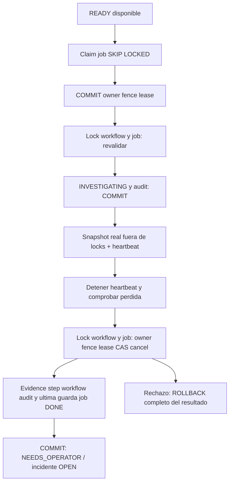

# S03 — revisión del worker T03-05

2026-10-24, Europe/Madrid. Alcance: T03-05 exclusivamente, trabajo local autorizado.
Autocrítica del mismo asistente; no auditoría independiente. Sin commit, push,
merge, release, despliegue, herramientas IT, LLM ni avance automático T03-06.
Resultados actuales: [verification.json](../../artifacts/session-03/worker/verification.json).
S03 abierta; AC03-04/05/06 parciales hasta T03-06. Sin GO S04/producción.

## 1. Estado inicial Git y baseline

Root C:/Users/manul/OneDrive/Escritorio/opspilot-ai, main limpio, HEAD y origin/main
6a873ec0a7b5450cd23109efa71618fda36b7bb7. T03-01..04 y hotfix ya publicados.
Se arrancó exclusivamente el Compose existente, sin reconstruir datos ni credenciales.
Baseline check Windows PASS; 666 PASS Windows y 666 PASS Linux, sin fallos/skips.
Los baselines de integración se solaparon parcialmente; ambos terminaron PASS.
La regresión final se ejecuta secuencialmente por el TTL temporal del IdP en T03-04.
No se acredita CI remota de estos cambios locales.

## 2. Diseño del worker

[Entrypoint](../../src/opspilot/entrypoints/worker.py) independiente de FastAPI.
[Jobs](../../src/opspilot/workflows/application/jobs.py) ofrece puertos de aplicación;
[dominio](../../src/opspilot/workflows/domain/jobs.py) define Claim/Started/IntakeRecord
y hashes. [PostgresJobs](../../src/opspilot/adapters/postgres/jobs.py) implementa SQL,
guardas, evidencia y transición auditada. PostgresJobUow hereda begin/rollback/close
del PostgresUow existente; clasifica fallos SQL y COMMIT sin imprimir sus detalles.
Sin dependencia, broker, servicio, migración, grant o endpoint nuevos.

## 3. Archivos modificados

Cuatro módulos de producto nuevos: dominio/jobs, aplicación/jobs, postgres/jobs y
entrypoints/worker. Tests nuevos de unidad, contratos, arquitectura e integración,
con helper worker_process exclusivamente de pruebas. Spec worker, esta revisión,
handoff, tareas/checklist, motor, runbook, riesgos y trazabilidad actualizados.
Manifest propio enumera inputs/hashes; snapshots históricos conservados.

## 4. Contratos implementados

workflow-step-v1, incident-snapshot-v1, workflow-snapshot-v1 y eventos v2 existentes.
Camino nominal QUEUED → INVESTIGATING / LOCAL_STEP_STARTED y después
INVESTIGATING → NEEDS_OPERATOR / LOCAL_SNAPSHOT_RECORDED. Actor de servicio NULL;
trace de servidor, aggregate_version, definición, evidence_ids y hash ligados por
audit_append_v2 al estado confirmado. Incidents sigue OPEN/version 1.

## 5. Job Store y consultas SQL

Claim selecciona READY disponible por reloj PG, attempts < 3 y workflow elegible,
sin intención de cancelación. ORDER BY available_at,id; LIMIT 1 FOR UPDATE OF j
SKIP LOCKED. La consulta lee workflow sin bloquearlo: cancels concurrentes pueden
invalidar la versión o el job; start vuelve a comprobar todo bajo locks.
UPDATE job a LEASED, owner nuevo, fence+1, attempts+1 y lease PG de 60 s.
No reclaim implícito: LEASED vencido nunca vuelve a READY en este producto.

## 6. Claim y transacciones

Claim confirma antes de iniciar cualquier bloqueo workflow. Inicio, heartbeat,
resultado y pausa permanente usan workflow → job → step cuando aplica → audit.
La transacción inicial marca step RUNNING y workflow INVESTIGATING/version+1 con
audit. Retorna un registro real de incidents; cálculo/hash fuera del UoW.
Resultado: validación → INSERT evidence → step DONE → transición/version/audit →
UPDATE job DONE con última guarda temporal → COMMIT. Fallo revierte TODO el resultado;
el inicio confirmado permanece INVESTIGATING, sin evidencia parcial.

## 7. Leases y heartbeat

Reloj PostgreSQL, lease 60 s y thread de renovación cada 15 s; espera cancelable.
Renovación bloquea workflow antes del job, comprueba estado/definición/cancelación,
ownership y lease aún vigente. UPDATE repite el predicado temporal. Nunca resucita
lease vencida. Poll 2 s + jitter U(0,1 s) cuando no hay trabajo.
El heartbeat se detiene y se espera antes de confirmar: una renovación fallida no
puede competir con el check local de pérdida. Resultado corto comprueba DB de nuevo.
No se mantienen locks durante generación del snapshot. Esperas SQL/pool acotadas.

## 8. Fencing y prevención de stale commits

Cada claim lleva owner UUID aleatorio, fence, workflow y step. _locked compara
owner/fence/LEASED/lease y versión; complete exige INVESTIGATING/definición 1,
sin intención de cancelación, incidente y step consistentes. La última liberación
repite owner/fence/LEASED/lease después de esperar el appender. La prueba de espera
en audit hasta expiración verifica rollback de evidence/step/workflow/audit/job.
La comprobación temporal es en el último statement antes de COMMIT, no una garantía
de timestamp físico del commit ni un mecanismo para detener llamadas externas.

## 9. Interacción con cancelación CAS

Se reutiliza T03-04 sin cambios. Cancel puede ganar antes de claim, después del claim,
durante cálculo o antes del resultado; invalida ownership/fence y no se confirma
evidencia. Locks PG observados fuerzan ambos órdenes: cancel primero rechaza
complete; resultado primero confirma v3 y cancel v2 recibe VersionConflict.
Cancelar después del resultado usa v3, conserva la evidencia y el job DONE.
El trigger impide resucitar CANCELLED; no hay mutex Python que decida ownership.

## 10. Snapshot y evidencia

IntakeRecord lee incidents real, OPEN/version 1 y relación de creador/workflow.
SHA-256 de UTF-8 exacto de título/descripción; JSON canónico completo produce
content_hash. No trim, normalización Unicode ni texto de ticket en evidence.
Complete recalcula y compara bytes exactos para rechazar campos extra/bools/alteraciones.
Evidence INCIDENT_SNAPSHOT_V1, local-intake-v1, INTAKE_SNAPSHOT y
source_ref incident:UUID:v1. observed_at asignado por trigger PG. UNIQUE instalado
impide duplicados; sin upsert que oculte contenido incompatible. No demuestra
resolución ni verificación independiente.

## 11. Auditoría versionada y errores

Appender v2 existente, sin escritura directa a audit ni modificación de v1/0001/0002.
Errores del appender revierten la operación completa. Unknown definition conserva
estado/definición, version+1 y workflow.blocked/UNSUPPORTED_DEFINITION; job DEAD,
fence+1. Sin ejecutar handler v1 por defecto. Snapshot permanentemente fallido tras
inicio válido: step FAILED, NEEDS_OPERATOR/PERMANENT_LOCAL_FAILURE y job DEAD/audit
atómicos, sin retry. Invariantes/ownership/version/cancel/expiry tienen códigos
distintos; SQL transitorio, fallo DB, audit, COMMIT rechazado o incierto se distinguen.
Fallo DB/audit/commit detiene el proceso. Commit incierto exige releer PG; no presume
ausencia de commit. No se convierte toda excepción en retry.

## 12. Resultados Windows/Linux y seguridad

Regresión final: **715 PASS Windows y 715 PASS Linux**, cero fallos/errors/skips;
252 integraciones reales/OS, incluidas 38 nuevas del worker. Otras 11 nuevas:
7 unitarias, 2 contratos y 2 arquitectura. Harness separado: 23/23 por OS.
Linux usa contenedor Alpine/Python 3.13.14 sin root, no Ubuntu CI remoto.
Check completo Windows/Linux, dependencias, secretos, PG fresco UID 70 y tres
scans nuevos PASS, cero HIGH/CRITICAL. Fuente: verification.json/XML/scans propios.
La imagen runtime coincide con los 47 módulos de producto por hash; la imagen de
tests coincide con los 77 archivos fuente/tests del checkout. Sin herencia de PASS.
Worker exige DSN de archivo con username y sesión efectivos opspilot_worker,
NOINHERIT, sin membresías ni flags privilegiados; production exige TLS verify-full.
No recibe OIDC, IdP, admin, migration ni API DSN. Rol instalado sin permisos nuevos;
regresión conserva negativos DDL, identidad/grants/idempotency, audit directo y
evidence UPDATE. Logs JSON cerrados con worker/job/workflow/fence/versión/trace,
sin texto del ticket, owner, SQL, DSN ni traceback. No shell desde tickets.

## 13. Dos workers y 100 jobs

Tests crean DB efímera migrada con PG18 y credencial worker real. Dos procesos OS
independientes esperan stdin; compiten en el mismo store real. Casos de 1 y 100
jobs registran IDs, fences, per-worker counts, exit codes y evidencia confirmada.
Los eventos de claim/completion permiten comprobar un único claim lógico por job.
Reparto observado de los 100 jobs: Windows 50/50 y Linux 51/49; exit codes 0/0,
100 job DONE, 100 workflows NEEDS_OPERATOR, 100 evidencias y 200 eventos de workflow
por entorno. Cada job conserva fence 1 después de su claim inicial desde fence 0.
Los casos de un único job producen un solo claim y un solo resultado confirmado.
Otros casos observan locks PG, heartbeat real de 15 s, cancelación y reinicio tras
kill en claim/antes de resultado/después de commit. DONE no se reejecuta; LEASED
se retiene al reiniciar, recuperación automatizada pendiente T03-06.
Recovery adicional con PG realmente detenido/reiniciado: resultado del worker en
DB efímera conserva las filas de incident/workflow/step/job/evidence/audit; DONE no
se reclama de nuevo. Las once tablas del lab conservan conteos/hashes antes/después.
PG/IdP/API y nuevo login PKCE también PASS. No equivale a backup/restore ni reclaim.

## 14. Fallos y riesgos residuales

Primer focused: fallo real de tipado PG del parámetro state reutilizado en CASE;
corregido con parámetro entero independiente para fence. Fixture de deadline
intentaba UPDATE de fechas inmutables: sustituida por INSERT con fechas vencidas.
Pruebas posteriores corrigieron uso de helpers limitados a intake. Fallos y sus
hashes conservados; no se modificaron tests históricos ni constraints para pasarlos.
La primera regresión Windows cargó la expectativa anterior de diagnóstico CLI
mientras se completaba esa corrección: 713 PASS/1 FAIL conservados; repetición
con árbol estable 715 PASS. La corrección distingue COMMIT fallido también en claim.
Primera suite Linux con checkout Windows montado: 714 PASS/1 FAIL en la prueba
antigua de intake con dos APIs/20 requests. Un diagnóstico aislado falló readiness;
otro instrumentado observó 20 creaciones 202 y replay 202 exacto. Causa inicial
no confirmada; no se alteraron tests antiguos, timeouts ni políticas para pasarla.
Regresión completa posterior desde imagen nativa con fuentes contrastadas: 715 PASS.
El XML/log fallidos Linux se conservan privados porque pytest incluye valores de
fixtures; run-history publica únicamente resumen saneado y hashes.
El primer intento nativo con dev.py falló antes de pytest por re-sync del editable
sin permisos. UV_NO_SYNC=1 reutiliza el entorno de imagen ya construido; sin root,
sin instalar dependencias nuevas y con lock/dependencias comprobados por check.
R01 sigue abierto hasta recovery adversarial completo; R02/R14 externos, privacidad,
R15/mantenimiento musl/linux-amd64 y amenaza admin DB siguen vigentes.

## 15. Límite T03-06

No reclaim general, retry/backoff, available_at de reintentos, presupuesto acumulado
completo, reanudación de definiciones ni kill points exhaustivos. Se incrementa
attempts sin reset y se comprueba deadline/budget como guarda mínima. Deadline
vencido al inicio usa salida contratada; expiración durante resultado se rechaza
sin transición especulativa. Handoff de generaciones en tests es fixture admin,
no reclaim de producto. At-least-once es la semántica de diseño; T03-05 por sí solo
no acredita eventual recuperación de todos los jobs después de crash.
La rama COMMIT_UNCERTAIN está implementada de forma conservadora; esta entrega
prueba COMMIT rechazado real y kill después de commit, no una pérdida de transporte
exactamente durante el COMMIT del worker. Esa campaña integral sigue en T03-06.

## 16. GO/NO-GO local para T03-06

**GO técnico LOCAL para preparar T03-06**, con gates actuales PASS en verification.json.
Un invariante crítico fallido implica NO-GO. T03-06 exige nueva
petición y su suite propia; esta entrega se detiene antes de implementarla.
AC03-04/05/06 no se marcan completos. No GO global S03/S04/producción ni CI nueva.

## 17. Laboratorio y Git

Sin commit/push. Main/HEAD base conservados; cambios locales revisables en manifest.
Se detienen únicamente servicios y procesos propios de la prueba, conservando
pg_data, credenciales y snapshots. Lab: 4 principals/4 grants, 7 streams/11 eventos,
2 incidents/workflows/steps/jobs/idempotency y cero evidence, sin drift tras recovery.
Los 100 resultados de cada suite pertenecen a DBs efímeras propias, eliminadas tras
verificar, y no se insertan en el volumen principal. Estado efectivo en verification.json.
Parada: API y PG exit 0; Keycloak exit 137 tras stop (OOMKilled=false), como en el
baseline detenido. Worker processes exit 0 en pruebas nominales; kills intencionales
se registran aparte. No se interpreta 137 como cierre limpio del JVM.

## LO QUE DEBE COMPRENDER EL ARQUITECTO

SKIP LOCKED, en PostgresJobs.claim, salta un job bloqueado por otro reclamante;
permite repartir una cola entre procesos sin esperar ese lock. No demuestra
exactly-once ni bloquea al worker durante todo su cálculo.

Un lease es un permiso temporal almacenado, no el proceso Python. _live y _release
usan clock_timestamp de PG; el reloj del portátil no decide vigencia. Heartbeat
extiende ese permiso solo mientras siga válido. Si muere el worker, deja de renovar;
la fila permanece LEASED. T03-06 decidirá su recuperación; esta entrega la retiene.

Fence es una generación monotónica. Ejemplo: A obtiene fence 1 y calcula; un handoff
legítimo futuro devuelve el job a READY y B reclama fence 2. El resultado de A
presenta owner/fence antiguos: _locked lo rechaza antes de INSERT evidence. La
prueba usa una preparación administrativa explícita, sin fingir reclaim implementado.

CAS/version protegen otro eje: el workflow pudo cambiar por cancelación aunque el
proceso conserve su copia. Claim observa v1, start confirma INVESTIGATING/v2;
complete exige v2 y confirma v3. Cancelar v2 primero produce CANCELLED/v3 e invalida
el job: complete no escribe ni resucita el workflow. Si resultado gana, cancelar
con v2 da conflicto; el operador debe releer v3. Un fence no sustituye esta versión.

Con un único READY, A y B intentan claim. A bloquea la fila, incrementa fence y
confirma; B la salta mientras está bloqueada o la ve LEASED después. Solo A obtiene
ese claim. Si A muere después del resultado pero antes de observar su ack, el job
DONE y la UNIQUE de evidence evitan confirmar otro efecto lógico. At-least-once
permite repetir una ejecución cuando se recupere; no promete una única ejecución
física ni exactly-once en sistemas externos. NEEDS_OPERATOR es un resultado honesto:
se registró el intake; todavía no hay investigación IT, reparación ni verificador.
